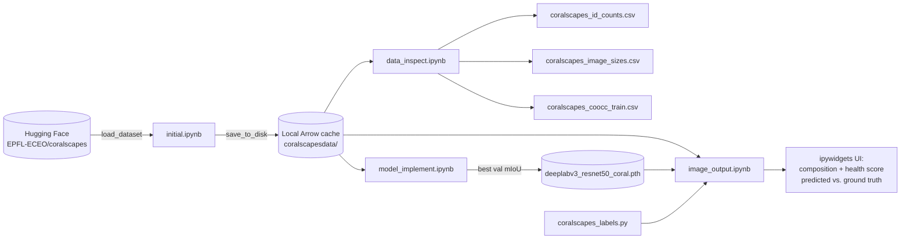

# Architecture

This document explains what the Coral Health Classification project does, how its pieces fit together, and the methods used at each stage — from raw dataset to a reef "health score" shown in an interactive notebook UI.

---

## 1. Purpose

The project estimates the **health of a coral reef from a single underwater photograph**. It does this in two steps:

1. **Semantic segmentation** — a DeepLabV3 / ResNet-50 network labels every pixel of the image with one of 40 Coralscapes class IDs (sand, rubble, branching coral alive, branching coral dead, sponge, and so on).
2. **Reef analytics** — the predicted mask is reduced to:
   - a **material composition** (what fraction of the image each class covers), and
   - a **health score**: the share of reef-benthos pixels that are *living* coral.

Both outputs are compared against the ground-truth mask so you can see how accurate the model is on any test image.

---

## 2. Repository layout

```
Coral-health-classification/
├── README.md                         # one-line title
├── ARCHITECTURE.md                   # this file
├── test.py                           # placeholder ("hello") — not part of the pipeline
├── coralscapes_id_counts.csv         # per-class pixel counts for each split (from data_inspect)
├── coralscapes_image_sizes.csv       # width/height/area of every image (from data_inspect)
├── model_saves/
│   └── Oct_seven_code.ipynb          # frozen snapshot of the first successful training run (5 epochs)
└── notebooks/
    ├── initial.ipynb                 # download Coralscapes from Hugging Face and cache to disk
    ├── data_inspect.ipynb            # exploratory data analysis (EDA)
    ├── model_implement.ipynb         # training pipeline (the main 30-epoch run)
    ├── image_output.ipynb            # inference, health scoring, evaluation and ipywidgets UI
    ├── coralscapes_labels.py         # CORALSCAPES_LABELS: class-ID → display-name dict (see §8.1)
    └── coralscapes_coocc_train.csv   # 39×39 image-level class co-occurrence matrix (train split)
```

Everything lives in Jupyter notebooks. There is no installable package, CLI or `requirements.txt`. The notebooks pass state between stages through files on disk: the cached dataset and the `.pth` model checkpoint, neither of which is committed.

---

## 3. End-to-end pipeline



| Stage | Notebook | Input | Output |
|---|---|---|---|
| 0. Acquire | `initial.ipynb` | Hugging Face Hub | `DatasetDict` saved with `save_to_disk` |
| 1. Explore | `data_inspect.ipynb` | Cached dataset | Plots and three CSV summaries |
| 2. Train | `model_implement.ipynb` | Cached dataset | `deeplabv3_resnet50_coral.pth` |
| 3. Infer and evaluate | `image_output.ipynb` | Dataset, checkpoint, label map | Per-image composition, health score, error, UI |

---

## 4. The dataset: Coralscapes

**Source:** [`EPFL-ECEO/coralscapes`](https://huggingface.co/datasets/EPFL-ECEO/coralscapes) on Hugging Face. It is a dense semantic-segmentation dataset of coral reef imagery.

| Property | Value |
|---|---|
| Splits | train **1,517**, validation **166**, test **392** (2,075 total) |
| Features | `image` (RGB `PIL.Image`), `label` (single-channel `PIL.Image` of integer class IDs) |
| Resolution | **every** image is 2048 × 1024 (confirmed in `coralscapes_image_sizes.csv`) |
| Label space | integer IDs **0–39** → `num_classes = 40` |

### 4.1 Label semantics

IDs 1–39 are the official Coralscapes classes. ID 0 does not appear in the official class table. It covers about 17% of training pixels and behaves like an "unlabeled" value, but the project treats it as an ordinary class (see §6.4).

These are the official names from the dataset card. They matter for the health score in §7.3:

| ID | Class | ID | Class | ID | Class |
|---|---|---|---|---|---|
| 1 | seagrass | 14 | dark | 27 | turbinaria |
| 2 | trash | 15 | transect line | 28 | table acropora alive |
| 3 | other coral dead | 16 | massive/meandering bleached | 29 | sponge |
| 4 | other coral bleached | 17 | massive/meandering alive | 30 | anemone |
| 5 | sand | 18 | rubble | 31 | pocillopora alive |
| 6 | other coral alive | 19 | branching bleached | 32 | table acropora dead |
| 7 | human | 20 | branching dead | 33 | meandering bleached |
| 8 | transect tools | 21 | millepora | 34 | stylophora alive |
| 9 | fish | 22 | branching alive | 35 | sea urchin |
| 10 | algae covered substrate | 23 | massive/meandering dead | 36 | meandering alive |
| 11 | other animal | 24 | clam | 37 | meandering dead |
| 12 | unknown hard substrate | 25 | acropora alive | 38 | crown of thorn |
| 13 | background | 26 | sea cucumber | 39 | dead clam |

### 4.2 Class imbalance

The training split is heavily imbalanced (from `coralscapes_id_counts.csv`):

| Class | Share of train pixels |
|---|---|
| 13 background | 21.6% |
| 0 (unlabeled) | 17.1% |
| 12 unknown hard substrate | 11.9% |
| 17 massive/meandering alive | 9.0% |
| 5 sand | 6.2% |
| 10 algae covered substrate | 5.1% |
| 14 dark | 5.0% |
| … | … |
| 11, 24, 26, 35, 39 | ≤ 0.03% each |

The seven largest classes cover about 76% of pixels. Several classes are entirely absent from validation (IDs 1 and 27). This imbalance is the main reason that pixel accuracy (~63%) is much higher than mIoU (~0.23): rare classes are hard to learn and pull the mean IoU down.

---

## 5. Stage 0–1: Acquisition and exploration

### 5.1 `initial.ipynb`

- Calls `datasets.load_dataset("EPFL-ECEO/coralscapes")` and then `save_to_disk(...)`, which writes 9 / 1 / 3 Arrow shards for train / validation / test.
- Every later notebook uses `load_from_disk(<path>)`, so the Hub is contacted only once.

### 5.2 `data_inspect.ipynb`

| Check / analysis | Method | Result / artifact |
|---|---|---|
| Schema | `print(dataset)`, `.features` | Two `Image` features per row |
| Visual sanity | Random train image and its mask, side by side (`cmap="tab20"`) | — |
| Per-image class mix | `np.unique(mask, return_counts=True)` → proportions, bar chart | — |
| Image/mask alignment | `assert image.size == label.size` on 10 samples per split | Passes |
| Label range | Union of `np.unique` over 50 samples per split | IDs 0–39 observed |
| Global pixel counts | Per-split `Counter` over every mask | `coralscapes_id_counts.csv` (rows = class ID, cols = split) |
| Co-occurrence | For each image, a 0/1 presence vector `p`; accumulate `M += outer(p, p)`; plot with `LogNorm` | `coralscapes_coocc_train.csv` |
| Resolution survey | Width/height/area per image; scatter plot and histogram (seaborn) | `coralscapes_image_sizes.csv` |

The co-occurrence matrix is image-level. Entry `M[i, j]` is the number of training images that contain both class *i* and class *j*, and the diagonal `M[i, i]` is the number of images containing class *i*. Because `N_CLASSES = 39` was used, class 39 is clamped out and the saved matrix is 39 × 39 (IDs 0–38).

---

## 6. Stage 2: Training (`model_implement.ipynb`)

### 6.1 Data utilities

| Function / class | Responsibility |
|---|---|
| `to_pil(img)` | Normalises any image-like input (PIL, NumPy, float, RGBA) to an 8-bit PIL image. Values are clipped to [0, 255] and the alpha channel is dropped. |
| `mask_to_pil(mask)` | Normalises a mask to a single-channel `"L"` PIL image of `uint8` class IDs. |
| `get_num_classes(split, sample_limit)` | Scans masks for the maximum label and returns `max + 1`. On the full train split this gives **40**. |
| `SegTransform` | Joint image/mask preprocessing and augmentation (§6.2). |
| `HFDatasetWrapper` | `torch.utils.data.Dataset` adapter around a Hugging Face split. `__getitem__` returns `(image_tensor, mask_tensor)`. |
| `collate_fn` | Stacks the images to `[B, 3, H, W]` and the masks to `[B, H, W]`. |

### 6.2 `SegTransform`: paired preprocessing

The key invariant is that **the image and the mask receive the exact same geometric transform**, so the pixels stay aligned.

```
image ──► to_pil → RGB ──► resize(shorter side = 320, BILINEAR) ─┐
mask  ──► mask_to_pil  ──► resize(shorter side = 320, NEAREST)  ─┤
                                                                 ▼
                     train: RandomCrop 320×320 (same i,j,h,w for both)
                            + HorizontalFlip p=0.5 (both)
                            + ColorJitter(b=0.2, c=0.2, s=0.2, h=0.05) (image only)
                     eval:  CenterCrop only if crop < size  (here crop == size → no crop)
                                                                 ▼
image ──► to_tensor → Normalize(ImageNet mean/std) → float [3,H,W]
mask  ──► int64 tensor [H,W] of class IDs
```

- **Nearest-neighbour** interpolation on masks prevents resizing from inventing new class IDs at boundaries.
- `T.RandomCrop.get_params` samples the crop window once, and that window is applied to both tensors.
- With `TRAIN_SIZE = CROP = 320`, a 2048×1024 image becomes **640×320**:
  - **Training** uses random 320×320 crops.
  - **Validation and test** use the full 640×320 frame, because there is no centre crop when `crop == size`.
- ImageNet normalisation matches the statistics of the pretrained backbone.

> Cell 8 of the notebook redefines `SegTransform` without `ColorJitter`, but that cell was never executed (it has no execution count). The recorded 30-epoch run therefore used the ColorJitter version from cell 2.

### 6.3 Model

```python
model = torchvision.models.segmentation.deeplabv3_resnet50(num_classes=40)
```

- **Backbone:** ResNet-50. Under torchvision's defaults (`weights=None`, `weights_backbone=IMAGENET1K_V1`), the backbone is initialised from ImageNet while the segmentation head is trained from scratch. The last two ResNet stages use dilated convolutions instead of striding, which gives an output stride of 8.
- **Head:** DeepLabV3's **ASPP** (Atrous Spatial Pyramid Pooling). Parallel 3×3 convolutions with dilation rates 12, 24 and 36, plus a 1×1 convolution and global image pooling, capture context at several scales. The head then projects to 40 output channels.
- **Output:** `model(x)["out"]` has shape `[B, 40, H, W]`; the logits are bilinearly upsampled back to the input resolution. No auxiliary head is used.

### 6.4 Optimisation

| Component | Setting | Notes |
|---|---|---|
| Loss | `CrossEntropyLoss(ignore_index=-1)` | No mask contains −1, so **every pixel, including ID 0, is supervised**. No class weighting. |
| Optimiser | `AdamW(lr=3e-4, weight_decay=1e-4)` | |
| LR schedule | `OneCycleLR(max_lr=3e-4, epochs=30, steps_per_epoch=len(train_loader))` | Stepped **per batch**: warm-up followed by cosine annealing. |
| Batch size | train 3, val 4, test 4 | `num_workers=0` |
| Mixed precision | `GradScaler` is created but never used | No `autocast` is applied, so training runs in FP32. |
| Device | `cuda` if available, otherwise CPU | The recorded runs were on **CPU**. |

### 6.5 Training loop (`run_epoch`)

For each batch: forward pass → loss → (train only) `zero_grad` → `backward` → `optimizer.step` → `scheduler.step`. Then `segmentation_metrics` is computed on the detached logits. The function returns the mean loss, pixel accuracy and mIoU across batches.

The outer loop runs `EPOCHS = 30`. After every epoch it evaluates on validation and **checkpoints whenever validation mIoU improves**:

```python
torch.save({"model": model.state_dict(), "num_classes": num_classes}, save_path)
```

After training, the best checkpoint is reloaded and scored on the test split.

### 6.6 Metrics (`segmentation_metrics`)

- **Pixel accuracy** = correct pixels / all pixels.
- **mIoU**: for each class *c*, IoU = |pred = c ∧ target = c| / |pred = c ∨ target = c|. Classes with an empty union are skipped, and the mean is taken over the remaining classes.

These are **batch-level** values that are then averaged over batches. They are not a dataset-level confusion-matrix mIoU, so they will differ somewhat from standard benchmark numbers (§8.3).

### 6.7 Results

| Run | Location | Crop | Augment | Epochs | Best val mIoU | Test pixel acc | Test mIoU |
|---|---|---|---|---|---|---|---|
| First successful run | `model_saves/Oct_seven_code.ipynb` | 320 → 288 | crop + flip | 5 | 0.145 | 0.498 | 0.156 |
| Main run | `notebooks/model_implement.ipynb` | 320 → 320 | crop + flip + ColorJitter | 30 | **0.224** (epoch 30) | **0.635** | **0.230** |

Each epoch of the main run took about 5,100 s on CPU, so the full run took roughly 42 hours. Training loss fell from 2.82 to 0.75 while validation loss levelled off at about 1.17. Train mIoU (0.35) is noticeably higher than validation mIoU (0.22), which suggests mild overfitting.

---

## 7. Stage 3: Inference, health scoring and UI (`image_output.ipynb`)

### 7.1 `inference_transform(pil_img)`

This mirrors the evaluation branch of `SegTransform`: convert to RGB → resize the shorter side to 320 (bilinear) → optional centre crop → tensor → ImageNet normalisation. A 2048×1024 input becomes `[3, 320, 640]`, which is **204,800 predicted pixels**.

### 7.2 `predict_image(image_input, model, num_classes)`

1. Accepts a file path, a `PIL.Image` or an array-like input.
2. Runs the model on CPU under `@torch.no_grad()` and takes `argmax` over the channels to get `pred` (an `[H, W]` `uint8` mask).
3. **Composition:** `np.bincount(pred.ravel(), minlength=num_classes)` → `{class_id: (pixel_count, fraction_of_image)}` for each class that is present.
4. **Health score:** see §7.3.
5. Returns `{health_score, coral_pixels, healthy_coral_pixels, composition, pred_mask}`.

### 7.3 Health score definition

Two hand-curated sets of IDs, which match the official label map in §4.1, define the score:

```python
coral_ids   = {3,4,6,10,16,17,18,19,20,21,22,23,25,27,28,29,30,31,32,33,34,36,37}  # reef benthos
healthy_ids = {6,17,21,22,25,27,28,31,34,36}                                         # live coral
```

- **`coral_ids` (the denominator)** covers all reef benthos: coral in every state (alive, bleached, dead), algae-covered substrate, rubble, sponge and anemone.
- **`healthy_ids` (the numerator)** covers only classes labelled *alive*: other coral, massive/meandering, millepora, branching, acropora, turbinaria, table acropora, pocillopora, stylophora and meandering.

```
health_score = Σ pixels(healthy_ids) / Σ pixels(coral_ids)      (None if no reef pixels)
```

`health_score_processing(x)` turns this into a percentage rounded to two decimals. It returns `None` for `None`, NaN or infinite inputs.

### 7.4 Ground truth and error

- `compute_composition_and_health(mask)` applies the same composition and health logic to the **ground-truth** mask at its native 2048×1024 resolution. It supports an optional `ignore_index`. Fractions are resolution-independent, so predicted and true compositions can be compared directly even though the pixel counts differ.
- **Health error**:
  - `sample_and_predict` reports `pred_health − gt_health` in **percentage points**.
  - An earlier exploratory cell reports the relative error (`(pred − gt) / gt × 100`).
  - Example from the notebook: predicted 90.73 vs. true 80.74, a +9.99 pp difference (12.37% relative).
- **Composition accuracy** (`composition_accuracy_fraction`): the two compositions are aligned into 40-length fraction vectors *p* (predicted) and *g* (ground truth), and

  ```
  accuracy = 1 − ½ · Σᵢ |pᵢ − gᵢ|        (= 1 − total variation distance)
  ```

  The result is 1.0 when the class proportions match exactly and 0.0 when the two masks share no classes. Because it compares proportions only, it ignores *where* each class is in the image.

### 7.5 `sample_and_predict(idx=None)`

This function ties the pieces together for one test example, or a random one if `idx` is `None`. It returns a `Result` namedtuple:

```
Result(idx, image, pred_comp, pred_health, gt_comp, gt_health, error)
```

### 7.6 Interactive UI (ipywidgets)

```
┌───────────────────────────────────────────────────────────┐
│ Index: [ leave blank for random ]   [ New sample ]        │
│ status: Running… / Error: …                               │
├───────────────────────────────────────────────────────────┤
│ Sample Index: N                                           │
│ Material Analysis                                         │
│  Predicted composition        │ Ground-truth composition  │
│  Class (ID) | Pixels | %      │ Class (ID) | Pixels | %   │
│ Composition accuracy: XX.XX%                              │
│ Health Analysis                                           │
│  Predicted: XX.XX% | True: XX.XX% | Error (vs GT): ±X.XX  │
│ [ reef image ]                                            │
└───────────────────────────────────────────────────────────┘
```

- `on_click` parses the index, disables the button while running, calls `sample_and_predict` and then `render_result`, and shows any exception in the status label.
- `render_result` clears the `Output` widget, then renders the two composition tables side by side with `pretty_print_composition_to_output`, the composition accuracy, the health comparison and the image.
- Class names come from `CORALSCAPES_LABELS` in `coralscapes_labels.py`. This file must be importable, so the notebook needs to run with `notebooks/` as its working directory.

The UI depends on these globals being defined by earlier cells: `model`, `handydandy` (the cached dataset), `coral_ids`, `healthy_ids` and `CORALSCAPES_LABELS`.

---

## 8. Known issues and caveats

### 8.1 Display names do not match the dataset's label map ⚠️

`notebooks/coralscapes_labels.py` uses names such as "Coral (Acropora)", "Dead Coral" and "Bleached Rock". These **do not match** the official Coralscapes IDs in §4.1. For example:

| ID | `coralscapes_labels.py` says | Official class |
|---|---|---|
| 6 | Dead Coral | other coral alive |
| 13 | Rubble | background |
| 17 | Water Column | massive/meandering alive |
| 31 | Bleached Rock | pocillopora alive |

As a result, the UI tables label classes incorrectly. A "Bleached Rock" row is actually live Pocillopora. The health computation is **not** affected, because `coral_ids` and `healthy_ids` were chosen against the official map. To fix the display, replace the dict contents with the official names (and decide on a name for ID 0, such as "unlabeled").

### 8.2 Training and data choices

- **ID 0 is trained as a real class** (`ignore_index=-1`). If ID 0 really means "unlabeled", using `ignore_index=0` would stop the model spending capacity on it and make the metrics more meaningful.
- **No class weighting or resampling**, despite the imbalance described in §4.2. Weighted cross-entropy, focal loss or Dice loss would probably raise mIoU on rare coral classes.
- **Low input resolution.** Inference runs at 640×320, about 1/10 of the native pixels, so fine structures such as small colonies and thin branches are lost.
- **No model selection on the health score.** Checkpoints are chosen by validation mIoU, not by health-score error.

### 8.3 Metrics

- mIoU is computed per batch and then averaged, skipping classes that are absent from the batch. A dataset-level confusion matrix would give the standard, comparable number.
- Validation and test are evaluated at 640×320, not at native resolution.

### 8.4 Code robustness

- `sample_and_predict` calls `float(pred_health)` and `float(act_health)`. If an image contains no reef pixels, the value is `None` and the call raises `TypeError`, which the UI shows as an error message.
- `predict_image` hard-codes `.to("cpu")` and ignores any available GPU.
- `GradScaler` is created but never used.
- `render_result` builds `pred_df` and `gt_df` with `comp_to_df` but never displays them.
- `SegTransform` and `inference_transform` duplicate the same preprocessing, and `TRAIN_SIZE`/`CROP` are re-declared in `image_output.ipynb`. A change in one place has to be copied by hand to the other.

### 8.5 Reproducibility

- Dataset and checkpoint paths are **hardcoded absolute Windows paths** that differ between notebooks.
- No random seeds are set (Python `random`, NumPy or torch).
- There is no `requirements.txt` or environment file.
- `notebooks/__pycache__/*.pyc` is committed.

---

## 9. Running the project

### Dependencies

`datasets`, `torch`, `torchvision`, `numpy`, `pillow`, `matplotlib`, `seaborn`, `pandas`, `ipywidgets` and Jupyter.

### Steps

1. **Cache the data.** Run `initial.ipynb` once, after pointing `save_to_disk`/`load_from_disk` at a local folder.
2. **(Optional) Explore.** Run `data_inspect.ipynb` to regenerate the plots and CSVs.
3. **Train.** In `model_implement.ipynb`, update the dataset path and `save_path`, then run every cell **except cell 8**. A GPU is strongly recommended: the 30-epoch run took about 42 hours on CPU.
4. **Infer and explore.** In `image_output.ipynb`, update the dataset and checkpoint paths, run from the `notebooks/` directory so `coralscapes_labels` imports, execute the cells in order, then use the **New sample** button.

### Checkpoint format

```python
{"model": state_dict, "num_classes": 40}
```

To load it, build `deeplabv3_resnet50(num_classes=40)`, call `load_state_dict(ckpt["model"])`, then `eval()`.

---

## 10. Extension points

| Goal | Where to change |
|---|---|
| Different health definition (e.g. penalise bleached coral separately) | `coral_ids` / `healthy_ids` in `image_output.ipynb` |
| Higher resolution or a different crop | `TRAIN_SIZE` / `CROP` in **both** training and inference notebooks |
| Different architecture (e.g. SegFormer, DeepLabV3+) | Model cell in `model_implement.ipynb`; keep the `["out"]` output convention or adapt `run_epoch` and `predict_image` |
| Class-imbalance handling | `criterion` (add `weight=`, or swap in a focal or Dice loss) |
| Visual overlay of the predicted mask | The commented-out `PALETTE` / overlay block in `predict_image` |
| Batch evaluation of health error over the whole test set | Loop `sample_and_predict(i)` over `range(len(handydandy["test"]))` and aggregate `error` and composition accuracy |
