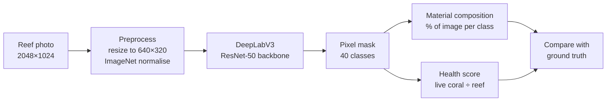
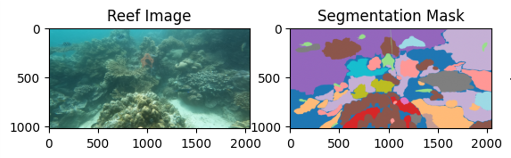
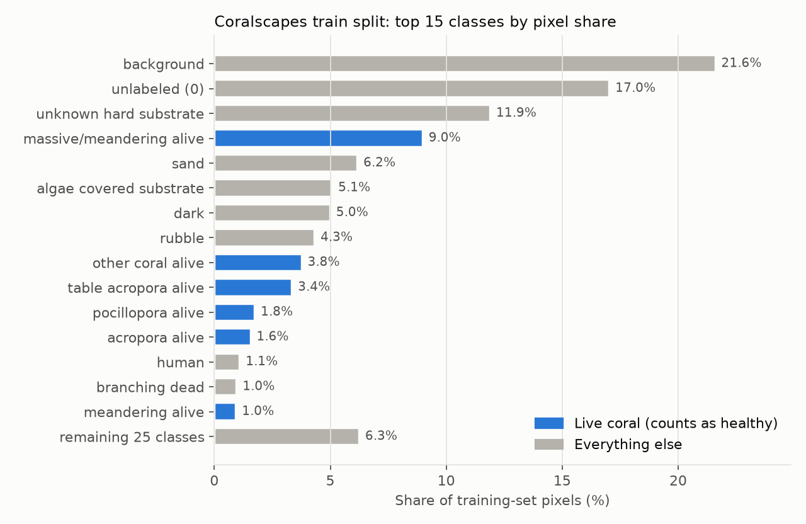
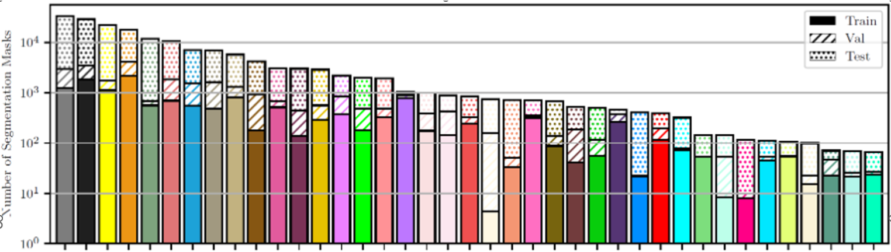
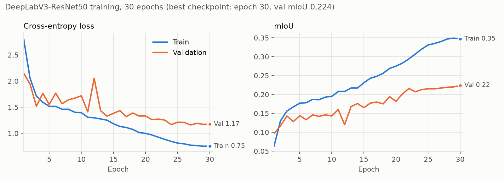

# Coral Health Classification

**Estimating coral reef health from a single underwater photo using pixel-level semantic segmentation.**


---

## Overview

Coral reefs are declining because of bleaching, disease and physical damage, and tracking that decline usually means divers or analysts annotating survey photos by hand. This project automates part of that work.

A deep-learning model labels **every pixel** of a reef photo as one of 40 classes, such as *branching coral alive*, *table acropora dead*, *rubble* or *sand*. Those labels are then reduced to two numbers a person can act on:

- **Material composition**: how much of the image each class covers.
- **Health score**: the percentage of reef pixels that are **living coral**.

Every prediction can be checked against the ground-truth annotation in an interactive notebook UI.

| Metric (test split, 392 images) | Value |
|---|---|
| Pixel accuracy | **63.5%** |
| Mean IoU | **0.230** |

---

## How it works



### The health score

Each predicted class is placed in one of two groups:

| Group | Classes | Role |
|---|---|---|
| **Reef benthos** | All coral (alive, bleached and dead), algae-covered substrate, rubble, sponge, anemone | Denominator |
| **Live coral** | Every class labelled *alive*, plus millepora and turbinaria | Numerator |

```
health score = live-coral pixels / reef-benthos pixels × 100
```

Water, sand, background, fish, divers and survey equipment are left out, so the score reflects the reef itself rather than what else happens to be in the frame.

---

## Dataset

The project uses [**Coralscapes**](https://huggingface.co/datasets/EPFL-ECEO/coralscapes) from EPFL-ECEO, a dense semantic-segmentation dataset of coral reef imagery.

| | Train | Validation | Test |
|---|---|---|---|
| Images | 1,517 | 166 | 392 |
| Resolution | 2048 × 1024 | 2048 × 1024 | 2048 × 1024 |

Every image comes with a mask in which each pixel holds a class ID from 0 to 39.


<sub>A training image (left) and its annotated mask (right). Each colour is a different class. The colours come from matplotlib's `tab20` colormap and are not a legend.</sub>

### Class imbalance

The classes are far from balanced. Background, unlabeled pixels and unknown substrate make up half of all training pixels, while most coral classes each cover less than 2%.



The same pattern shows up when counting the number of segmentation masks per class across splits, on a log scale:


<sub>Figure from the Coralscapes dataset paper.</sub>

This imbalance is the main reason pixel accuracy (63.5%) is much higher than mean IoU (0.23). Common classes are easy to get right, but rare coral types pull the per-class average down.

---

## Model and training

| | |
|---|---|
| Architecture | DeepLabV3 (ASPP head) on a ResNet-50 backbone, with the backbone pretrained on ImageNet (torchvision) |
| Input | Shorter side resized to 320, so images become 640×320; random 320×320 crops during training |
| Augmentation | Random crop, horizontal flip (p = 0.5), colour jitter (brightness, contrast, saturation, hue) |
| Loss | Cross-entropy, unweighted |
| Optimiser | AdamW, learning rate 3e-4, weight decay 1e-4 |
| Learning-rate schedule | One-cycle, stepped every batch |
| Batch size | 3 |
| Epochs | 30, keeping the checkpoint with the best validation mIoU |
| Hardware | CPU only, about 85 minutes per epoch and about 42 hours in total |



Validation mIoU kept improving throughout training and peaked at the final epoch. The widening gap between train and validation shows some overfitting.

### Results

| Run | Epochs | Augmentation | Best val mIoU | Test pixel acc. | Test mIoU |
|---|---|---|---|---|---|
| First run ([`notebooks/archive/2025-10-07_first_run.ipynb`](notebooks/archive/2025-10-07_first_run.ipynb)) | 5 | crop + flip | 0.145 | 49.8% | 0.156 |
| **Main run** ([`notebooks/03_train_model.ipynb`](notebooks/03_train_model.ipynb)) | 30 | crop + flip + colour jitter | **0.224** | **63.5%** | **0.230** |

---

## Interactive demo

[`notebooks/04_inference_ui.ipynb`](notebooks/04_inference_ui.ipynb) loads the trained model and provides a small ipywidgets interface. You can enter a test-set index or leave it blank for a random image, then click **New sample**.

```
┌────────────────────────────────────────────────────────────┐
│ Index: [ leave blank for random ]   [ New sample ]         │
├────────────────────────────────────────────────────────────┤
│ Material Analysis                                          │
│  Predicted composition        │  Ground-truth composition  │
│  Class (ID)  | Pixels | %     │  Class (ID)  | Pixels | %  │
│  Composition accuracy: XX.XX%                              │
│                                                            │
│ Health Analysis                                            │
│  Predicted: 90.73% | True: 80.74% | Error: +9.99 pts       │
│                                                            │
│  [ reef image ]                                            │
└────────────────────────────────────────────────────────────┘
```
<sub>Layout sketch. The health figures are from the example in the notebook.</sub>

**Composition accuracy** measures how closely the predicted class proportions match the true ones:

```
accuracy = 1 − ½ · Σ |predicted share − true share|
```

A score of 100% means the proportions are identical. The score doesn't consider *where* each class appears in the image.

---

## Repository structure

```
Coral-health-classification/
├── notebooks/                        # Run in numbered order
│   ├── 01_download_data.ipynb        # Download Coralscapes and cache it locally
│   ├── 02_explore_data.ipynb         # Data exploration: class counts, co-occurrence, image sizes
│   ├── 03_train_model.ipynb          # Training pipeline (main 30-epoch run)
│   ├── 04_inference_ui.ipynb         # Inference, health scoring and interactive UI
│   └── archive/
│       └── 2025-10-07_first_run.ipynb  # Snapshot of the first successful run (5 epochs)
├── src/
│   └── coralscapes_labels.py         # Class ID → display name
├── data/
│   ├── README.md                     # Where the dataset cache goes
│   ├── coralscapes/                  # Local dataset cache (git-ignored)
│   └── stats/                        # EDA outputs: pixel counts, image sizes, co-occurrence
├── models/
│   ├── README.md                     # Checkpoint format and how to load it
│   └── *.pth                         # Trained checkpoints (git-ignored)
├── docs/images/                      # Figures used in this README
├── ARCHITECTURE.md                   # In-depth technical documentation
└── requirements.txt                  # Python dependencies
```

---

## Getting started

### 1. Install dependencies

```bash
pip install -r requirements.txt
```

### 2. Run the notebooks in order

| Step | Notebook | What it does |
|---|---|---|
| 1 | `01_download_data.ipynb` | Downloads Coralscapes (about 2,000 images) and saves it to disk |
| 2 | `02_explore_data.ipynb` | Optional. Regenerates the plots and CSV summaries |
| 3 | `03_train_model.ipynb` | Trains the model and saves `deeplabv3_resnet50_coral.pth`. A GPU is strongly recommended. |
| 4 | `04_inference_ui.ipynb` | Loads the checkpoint and launches the interactive UI |

> **Before running:** the dataset and checkpoint paths are hardcoded Windows paths. Update the `load_from_disk(...)`, `save_path` and checkpoint paths in each notebook to match your machine; the suggested locations are `data/coralscapes/` and `models/` (see [data/README.md](data/README.md) and [models/README.md](models/README.md)). Run the notebooks from the `notebooks/` directory so that `04_inference_ui.ipynb` can import `src/coralscapes_labels.py`.

The trained checkpoint isn't included in this repository, so you need to train the model before you can run step 4.

---

## Limitations and future work

- **Display names.** The names in `src/coralscapes_labels.py` don't match the official Coralscapes class list, so the UI shows the wrong names. The health score is unaffected because it uses the official IDs.
- **Low resolution.** The model sees about a tenth of each image's pixels, which loses detail on small or thin coral.
- **Class imbalance isn't addressed.** Weighted or focal loss, or oversampling images that contain rare classes, should improve accuracy on coral classes.
- **Augmentation.** Adding random multi-scale resizing, as in SegFormer-style training recipes, would help the model handle corals at different distances from the camera.
- **Architecture.** A transformer-based model such as SegFormer, or DeepLabV3+, could be compared against the current model.
- **Evaluation.** The health-score error should be measured across the whole test set, not just on individual samples.

See [ARCHITECTURE.md](ARCHITECTURE.md) for full details of the pipeline, methods and known issues.

---

## Acknowledgements

- **Dataset:** [Coralscapes](https://huggingface.co/datasets/EPFL-ECEO/coralscapes) by EPFL-ECEO.
- **Model:** the DeepLabV3 implementation from [torchvision](https://pytorch.org/vision/stable/models/deeplabv3.html).
